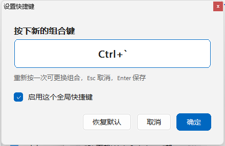
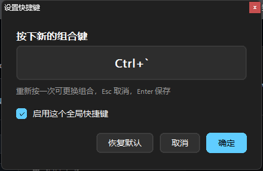
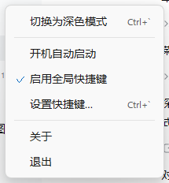
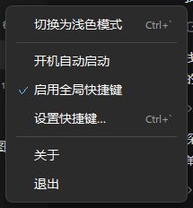
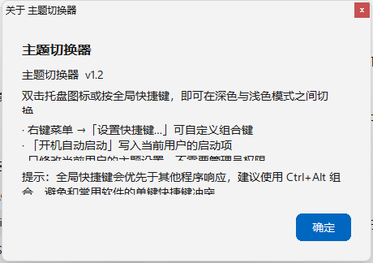

# Windows 11 深/浅色主题切换器（TrayThemeToggle）

任务栏托盘一键切换 Windows 深色 / 浅色模式的小工具。单文件、免安装、不需要管理员权限。

菜单和窗口都跟随系统主题，深色模式下不会出现白底弹窗。

## 功能

| 操作 | 效果 |
|---|---|
| **双击托盘图标** | 翻转当前主题 |
| **右键托盘图标** | 弹出菜单：切换主题 / 开机自启 / 启用快捷键 / 设置快捷键… / 关于 / 退出 |
| **全局快捷键**（默认 `Ctrl+Alt+S`，可自定义） | 翻转当前主题 |
| **`--toggle`** | 静默翻转一次后退出，适合做快捷方式、脚本、Stream Deck 按钮 |
| **`--settings`** | 直接弹出快捷键设置窗口 |
| **`--diagnose`** | 自检，把结果写到 `diagnose.log` |

托盘图标会跟着状态变：**浅色 = 太阳 ☀，深色 = 月亮 ☾**。鼠标悬停可看到「当前：浅色　|　右键菜单　|　Ctrl+Alt+S → 深色」这样的提示，键名会跟随自定义的组合变化。

## 界面

设置窗口与右键菜单都跟随系统主题：

| | 浅色 | 深色 |
|---|---|---|
| 设置窗口 |  |  |
| 右键菜单 |  |  |



Win11 风格细节：

- DWM 圆角 + 深色标题栏，标题栏、边框与内容区颜色一致
- 圆角卡片式输入框和按钮，主按钮使用系统强调色
- 菜单项悬停高亮、勾选标记、右对齐快捷键提示
- 全部自绘 + 双缓冲，不闪；按钮有 hover / pressed 状态
- 字体使用 `Segoe UI Variable`（老系统自动回落 `Segoe UI`）
- Per-Monitor V2 DPI，150% / 200% 缩放下依然清晰

> Win32 的 `TrackPopupMenu` 和 `MessageBox` 不响应深色主题，只会给白底黑字，所以菜单和对话框都改成了 GDI 自绘，配色走同一套调色板。

## 自定义快捷键

**右键托盘图标 →「设置快捷键…」**，点一下输入框，然后直接按下想要的组合键。

- 支持 `Ctrl` / `Alt` / `Shift` / `Win` + 字母、数字、F1~F12、方向键等
- 只按修饰键时显示 `Ctrl+…`，等主键按下才记录
- `Esc` 取消，`Enter` 确认
- 「恢复默认」回到 `Ctrl+Alt+S`
- 设置存到注册表，重启后保留

默认用 `Ctrl+Alt+S` 而不是 `Ctrl+S`，是因为 `Ctrl+S` 是几乎所有程序的「保存」，做成全局热键会让你在 Word、VS Code 里按不出保存。若某个组合已被其他程序占用，保存时会提示注册失败，换一个即可。

菜单里的「启用全局快捷键」可以整体关掉快捷键，只用托盘双击。

## 配置存放位置

```text
HKCU\Software\TrayThemeToggle
    HotkeyModifiers  = 3       ← 位标志：Alt=1, Ctrl=2, Shift=4, Win=8
    HotkeyVk         = 83      ← 虚拟键码（83 = 'S'）
    HotkeyEnabled    = 1
```

（`Ctrl+Alt+S` → Modifiers=3, Vk=83；`Ctrl+Alt+T` → Modifiers=3, Vk=84）

开机自启只需右键托盘图标 → 勾选「开机自动启动」，它会往 `HKCU\...\CurrentVersion\Run` 写一条，随时可以取消。

## 它改了什么

只动当前用户（HKCU）下的三个值：

```text
HKCU\Software\Microsoft\Windows\CurrentVersion\Themes\Personalize
    SystemUsesLightTheme = 0/1     ← 任务栏、开始菜单、系统 UI
    AppsUseLightTheme    = 0/1     ← 应用窗口
    ColorPrevalence      = 0       ← 切浅色时顺手关掉「标题栏显示主题色」
```

改完会广播系统消息（`WM_SETTINGCHANGE` + `ImmersiveColorSet`、`WM_THEMECHANGED`），让资源管理器立刻重绘，**不用注销也不用重启 explorer**。

不联网、不写自启动（除非你点菜单）、不注入进程、不创建子进程。

## 环境要求

- Windows 10 / 11
- 免安装、静态链接，不依赖任何 DLL
- 不需要管理员权限
